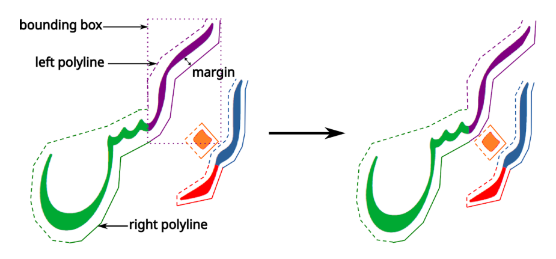

# PolyKern Lookup

M. Hosken, WSTech, SIL Global

# Introduction

This proposal presents a new lookup that implements a polyline outline based kern. The primary purpose for this lookup is to support kerning in situations of complex layout, in particular for Nastaliq Arabic fonts. There is already a tool that can create bubbles in Glyphs (BubbleKern) and then turn those into simple contextual lookups. But once the context becomes very complex, it is not feasible to create pure OpenType lookups to achieve what is necessary.

In creating a Nastaliq Arabic font, it is possible to produce an approximate horizontal kerning that allows for overlaps, etc. But it is very slow given the huge limitations of existing OpenType lookups.

# Description

The PolyKern lookup (GPOS lookup type 10\) is based around giving piecewise straight line boundaries (“polylines”) to the left and right of glyphs that need to be kerned. The goal of the algorithm is to shift the kernable glyphs such that their polylines abut the adjacent glyph without colliding. The process must also handle the fact that secondary glyphs may be attached to the base and their polylines must be taken into account as well. Particularly in Nastaliq, these secondary glyphs may include not only diacritics but also other bases that are attached cursively. Each glyph has two polylines, one on the left and the other on the right, to control the horizontal adjustment of the glyphs. The polylines are positioned in relation to the glyph outline so as to give the desired design margin between the closest point between two clusters. Each glyph's polylines are contained within a single bounding box, which differs from the bounding box of the glyph outline. The lookup adjusts the spacing between the two clusters in order that the combined right polylines of the left glyphs just touch the combined left polylines of the right glyphs.



The simplest OpenType model does not have the concept of clusters. Glyphs are positioned and any relationship between them lost. PolyKern kerns *skeleton clusters*. In Arabic script the skeleton is the run of letters joined together, without their marks; a skeleton cluster is a skeleton together with all the marks attached to it. (This is not the same as a Unicode or shaping cluster, which is roughly a character with its combining marks.) In the rest of this document a skeleton cluster is called simply a *cluster*.

In order to identify which glyphs are in a cluster we have to categorise them. The GDEF table categorises glyphs into marks and bases (with ligatures being a subtype of base). In addition we also need to identify glyphs that are marked as bases by GDEF but that are joined to the glyph before them, for example by cursive attachment. We call these attached bases and they are part of the cluster. Whether a base is an attached base is decided by its glyph ID alone, using a coverage table, not by any attachment the shaper has actually made. This suits fonts, such as most Arabic fonts, in which a glyph that joins to the glyph before it (a medial or final form) is always joined. Note that bases are often attached in the opposite order, so care must be taken in identifying which glyph IDs are considered attached bases for this lookup.

Spaces are glyphs in the base coverage table that have no boundary. A space glyph is kerned across but keeps its width. Thus a space glyph between two clusters is handled as if we were kerning the two clusters without the space and then the distance between them is increased by the width of the space. Glyphs that are in neither coverage table act as barriers: no kerning takes place across them.

It is not always the case that every glyph is to be kerned. For example, in Nastaliq, punctuation may need to be not kerned under a following word. Such a glyph may be left out of both coverage tables, so that it acts as a barrier, or it may be given a boundary that stops the following word moving under it. Also having coverage tables of ‘involved’ glyphs keeps the lookup in the same model as other GPOS lookups where the GPOS table is skipped for all glyphs not in the coverage table.

Each polyline is made up of straight line components. For simplicity, at any y position within the bounding box of the polyline, there may only be one point that is on the polyline. That is, a polyline may not have a vertical cup shape. In effect, it is convex in the x direction.

## Structure

The PolyKern lookup format is designed for in-memory processing. That is, the shaping engine does not need to create its own internal data structure from the lookup table and can access the table directly for what it needs.

_PolyPosFormat1 subtable_

| Type | Name | Description |
| :--- | :--- | :---------- |
| uint16 | format | Format identifier ― format \= 1 |
| Offset16 | baseCoverageOffset | Offset to a coverage table of all base glyphs to consider, including spaces |
| Offset16 | baseAttachedCoverageOffset | Offset to a coverage table of all base glyphs to be treated as attached bases. |
| Offset16 | boundariesArrayOffset | Offset to an array of boundaries for all glyphs in the font |

The `boundariesArray` contains a list of offsets to a boundary structure for each glyph. Offsets are relative to the start of the `boundariesArray`. Thus an offset of 0 may be used as a sentinel value. A value of 0 indicates that this glyph has no boundary information. For a glyph in the base coverage table this means it is a space. For a mark or attached base it means the glyph takes part in its cluster but adds no boundary. Glyphs in neither coverage table, and not marks, are barriers whatever their entry. Since this is a mapping between glyph and boundary, two different glyphs may share the same boundary.

_boundariesArray_

| Type | Name | Description |
| :--- | :--- | :---------- |
| Offset32 | boundary\[numGlyphs\] | Offset to a boundary structure for each glyph. numGlyphs comes from the maxp font table. |

The `boundary` structure contains 3 elements: a bounding box for the kerning polylines, such that all the points in `leftPoints` and `rightPoints` must lie within this bounding box, and two lists of points, one for each side of the glyph. The points in each list form a continuous polyline of straight lines. The two polylines are listed in sequence. The first is the left polyline and is described from the lowest y point in either polyline up to the highest y-point in any polyline. The y-value of a subsequent point in the line may not be less than the previous point. The second polyline immediately follows the left polyline and is the right polyline. It starts from the highest y-point (which is the same as the y-value of the last point in the left polyline, and proceeds downwards to the last point which has the same y-value as the first point in the left polyline. No point in the right polyline may have a y-value greater than the previous point. The result is a single outline describing the protected kerning area around the glyph. The whole outline is described within a bounding box which is also listed to speed up the lookup.

In some cases glyphs will never occur requiring a left or a right polyline. For simplicity of implementation in case the situation where such a polyline is required should occur, both polylines must exist, but nothing says both polylines need to reflect the glyph. A polyline may be a single line with a top and a bottom that goes straight through the glyph. Each polyline must have at least 2 points.

_boundary_

| Type | Name | Description |
| :--- | :--- | :---------- |
| uint8 | numLeftPoints | Number of points in the left side polyline |
| uint8 | numRightPoints | Number of points in the right side polyline |
| uint16 | reserved |  |
| Point | minPoint | Bottom left of polyline bounding box |
| Point | maxPoint | Top right of polyline bounding box |
| Point | leftPoints\[numLeftPoints\] | Points in the left boundary polyline from bottom to top |
| Point | rightPoints\[numRightPoints\] | Points in the right boundary polyline from top to bottom |

A `point` is a simple x/y pair in font units, taking a total of 32 bits.

_point_

| Type | Name | Description |
| :--- | :--- | :---------- |
| FWORD | x | x position |
| FWORD | y | y position |

## Algorithm

Here we describe an algorithm for processing the PolyKern lookup. Other algorithms may be used, so long as each resulting adjustment is within 1 font unit of the one described here. The description favours simplicity over speed.

### Glyph categories

Each glyph in the run is put into one of the following categories:

- **Ignored**: the glyph is skipped according to the lookup flags (for example `IgnoreMarks` or a mark filtering set).
- **Mark**: GDEF glyph class 3.
- **Attached base**: a non-mark glyph in the `baseAttachedCoverage` table.
- **Space**: a glyph in the `baseCoverage` table whose boundary offset is 0.
- **Kernable base**: any other glyph in the `baseCoverage` table.
- **Barrier**: any other glyph.

A cluster (a skeleton cluster, see above) is a run of consecutive glyphs in logical order, identified by its first and last glyph. A glyph *starts a cluster* if it is a kernable base, or if it is an attached base and the glyph before it is not a mark, an attached base, a kernable base or ignored. The cluster runs from that glyph through all the immediately following marks, attached bases and ignored glyphs.[^attached] A mark that does not follow a cluster is not part of any cluster. Each cluster is kerned against the glyphs before it, working backwards. A barrier stops all backward iteration: no glyph before a barrier is ever compared with a glyph after it, so nothing is kerned across a barrier.

### Positions

The algorithm uses the positions of the glyphs as they stand when the lookup is applied, with all mark and cursive attachments resolved. A PolyKern lookup must therefore come after all the lookups that attach glyphs in the clusters it kerns. Implementations whose attachment offsets are resolved only at the end of GPOS processing must resolve them before this lookup runs.

Positions are in font units, and x increases to the right whatever the text direction.

### Main algorithm

The glyphs are processed in logical order. Each cluster is kerned against the glyphs already placed before it, and then never moves again. So the clusters must be processed in order, and positions must include the adjustments already made.

Kerning a cluster changes exactly one advance. If there are spaces between the cluster and the previous cluster, it is the advance of the space next to the cluster being kerned. Otherwise it is the advance of the last glyph of the previous cluster (left to right) or of the first glyph of the cluster being kerned (right to left). In each case that advance spans the gap between the two clusters, so changing it moves the cluster, and everything after it, relative to everything before it. The space is used when there is one, as Graphite does, so that a large kern between words makes the space narrower, or negative, rather than a letter. Whenever this algorithm uses the advance of a space, or the width of a cluster, it means the *original advance*: the advance before this lookup changed it.

Clusters before the previous one may also need checking. A long tail, or a madda or other mark that overhangs the next few clusters, can reach past the previous cluster. So kerning a cluster walks backwards through the earlier glyphs. To know when to stop, the algorithm keeps a *reach*: the furthest point, in the direction of the text, reached by any boundary placed so far, plus the width of any spaces since. In left-to-right text the reach is the greatest right edge; in right-to-left text it is the least left edge. The reach as it was just before each cluster is kept in a list, one entry per cluster. Once the cluster being kerned is clear of the reach recorded for an earlier cluster, nothing before that cluster can touch it, and the walk stops. Apart from this list, the only things kept from one cluster to the next are the first and last glyphs of the previous cluster and its width (the total of the original advances of its glyphs).

```
1. Set the reach to none, and the list of reaches to empty. There is no previous cluster.
   Set the current glyph to the first glyph.
2. If there is no current glyph, stop.
3. If the current glyph is a space:
   3.1. If the reach is not none, increase it (left to right) or decrease it (right to left)
        by the original advance of the space.
   3.2. Set the current glyph to the next glyph, and go to step 2.
4. If the current glyph is a barrier:
   4.1. Set the reach to none. There is no previous cluster.
   4.2. Set the current glyph to the next glyph, and go to step 2.
5. If the current glyph is a mark, is ignored, or is an attached base after a mark or an
   ignored glyph, it is not in a cluster (clusters are passed over whole in step 12):
   5.1. Set the current glyph to the next glyph, and go to step 2.
6. The current glyph is a kernable base, or an attached base after a space, barrier, or
   at the start of the run. It is the first glyph of a new cluster, F. Go through its
   glyphs to find its last glyph, its width, and its box. F's box is the smallest box that
   encloses the boundary boxes of all its glyphs that have a boundary and are not ignored,
   each moved by the glyph's position:
   6.1. Set the last glyph to the current glyph. Set the width to 0, and the box to none.
   6.2. Add the original advance of the last glyph to the width. If the last glyph has a
        boundary and is not ignored, extend the box to include the glyph's own box: its
        minPoint and maxPoint moved by its position.
   6.3. If the glyph after the last glyph is a mark, an attached base or ignored, set the
        last glyph to that glyph and go to step 6.2.
7. Calculate the shift for F (see below).
8. If the shift is not none:
   8.1. If there is a previous cluster and the shift is less than minus its width, set the
        shift to minus that width.
   8.2. If the glyph before F is a space, or the text is left to right, increase the
        advance of the glyph before F by the shift. Otherwise increase the advance of
        the first glyph of F by the shift.
9. Append the reach to the end of the list of reaches.
10. If F has a box, update the reach to include F. Its far edge is its right edge plus
    the shift (left to right), or its left edge minus the shift (right to left), taking a
    shift of none as 0. If the reach is none, set the reach to the far edge. Otherwise set
    the reach to the greater (left to right) or lesser (right to left) of the reach and
    the far edge.
11. F is now the previous cluster.
12. Set the current glyph to the glyph after the last glyph of F, and go to step 2.
```

Step 8.1 stops *F* moving back past the start of the previous cluster. Without it, the start of a word can slide back over a short previous cluster until it hangs over the middle of the word before, even though no polylines touch. The limit is the advance width of the previous cluster, so *F*'s origin never moves back beyond the previous cluster's origin. Clusters still keep the order they have in the text. This limit only ever moves *F* further away, so it cannot cause a collision.

Without a space, the advance changed in step 8.2 is the one that spans the gap between the previous cluster and *F*. In left-to-right text, a glyph's advance runs rightwards from its origin to the next glyph, so it is the advance of the last glyph of the previous cluster. In right-to-left text, it runs from the glyph's origin rightwards to the glyph logically before it, so it is the advance of the first glyph of *F*. A space between them spans the same gap, so its advance can be changed instead. The original advances of spaces are kept for the extra separation because later clusters walk back past these spaces too. Implementations must make sure the change of advance does not disturb glyphs that are attached to other glyphs.

*Calculating the shift for F* (step 7 above) finds how far F should move relative to the glyphs before it, and returns it. It changes nothing; the main algorithm applies the result.

```
1. Set the shift to none, and the extra separation to 0. Set the current reach to the
   end of the list of reaches (just after its last entry).
2. If F has no box (none of its glyphs has a boundary), go to step 9.
3. Set the earlier glyph to the glyph before the first glyph of F.
4. If there is no earlier glyph, or it is a barrier, go to step 9.
5. If the earlier glyph is a space, add its original advance to the extra separation,
   and go to step 8.
6. If the earlier glyph has a boundary and is not ignored:
   6.1. Find the earlier glyph's box: its minPoint and maxPoint moved by its position.
        If it does not overlap F's box in y, go to step 7.
   6.2. Set the gap to the left edge of the right box minus the right edge of the left box,
        where F's box is the right box in left-to-right text and the left box in
        right-to-left text. If the shift is not none, and the extra separation minus the
        gap is no more than the shift, go to step 7.
   6.3. For each glyph of F that has a boundary and is not ignored:
        6.3.1. If the text is right to left, the left glyph is the glyph of F and the
               right glyph is the earlier glyph. Otherwise the left glyph is the earlier
               glyph and the right glyph is the glyph of F.
        6.3.2. Set dx to the right glyph's x position minus the left glyph's x position.
               Set dy to the right glyph's y position minus the left glyph's y position.
        6.3.3. If the boxes of the two glyphs, with the right glyph's box moved by dx and
               dy, do not overlap in y, skip to the next glyph of F.
        6.3.4. If the shift is not none, and the extra separation minus the gap between
               the boxes in x (the right glyph's box minimum x plus dx, minus the left
               glyph's box maximum x) is no more than the shift, skip to the next glyph
               of F.
        6.3.5. Calculate the separation of the left glyph and the right glyph, given dx
               and dy.
        6.3.6. If the separation is not none, take it away from the extra separation. If
               the shift is none or the result is greater than the shift, set the shift
               to the result.
7. If the earlier glyph starts a cluster:
   7.1. Move the current reach back one entry in the list of reaches. It is the reach
        recorded before that cluster.
   7.2. If the current reach is none, go to step 9.
   7.3. Set the gap to the left edge of F's box minus the current reach (left to right),
        or to the current reach minus the right edge of F's box (right to left).
   7.4. If the extra separation minus the gap is no more than the shift (taking a shift
        of none as 0), go to step 9.
8. Set the earlier glyph to the glyph before it, and go to step 4.
9. Return the shift.
```

The shift is a kern: the change in the space between *F* and the glyphs before it. A positive shift moves *F* away from them, and a negative one brings it closer. Each earlier glyph that *F* is compared with sets the least shift needed to keep clear of it, and the shift is the greatest of these. So once a shift has been found, glyphs further back can only increase it. Spaces fit in simply: each one passed on the walk back adds to the extra separation, which goes into every comparison from then on. The result is that the closest approach between *F* and any earlier boundary is exactly the width of the spaces between them. Clusters whose boundaries don't overlap vertically are not adjusted. Any tracking or justification should be applied after this lookup.

Steps 6.1 and 6.2 compare the earlier glyph with the whole of *F*, and steps 6.3.3 and 6.3.4 with each glyph of *F*, using the bounding boxes in the boundary structures to avoid calculating separations that cannot change the shift. Two glyphs whose boxes don't overlap in y have no separation. The separation of two glyphs is never less than the gap between their boxes, so if the extra separation minus the box gap is already no more than the current shift, the separation cannot increase it. Step 7 stops the walk back once no glyph before the cluster just reached could need a larger shift. Until a shift has been found, the test in step 7.4 uses 0. That is, the walk stops once nothing further back could collide with *F* where it is now, even though something further back might have pulled *F* towards it. This stops a cluster that overlaps nothing vertically from walking back to the start of the run.

When *F* would collide with a cluster before the previous one, the extra space needed to avoid it could be put in either of two places: between *F* and the previous cluster, or between the previous cluster and the one *F* would collide with. This algorithm puts it before *F*, so that kerns already calculated never change. The situation is rare in practice, and the choice makes little visible difference.

### Separation of two glyphs

The separation of a left glyph and a right glyph is the smallest horizontal gap between the right polyline of the left glyph and the left polyline of the right glyph. It is none if the polylines don't overlap vertically.

Call the right polyline of the left glyph *R*. Its points are taken in the order they are stored, from top to bottom. Call the left polyline of the right glyph *L*. Its points are also taken in the order they are stored, which is from bottom to top. Every point of *L* is treated as moved by dx and dy.

The gap changes linearly between the y values of the points. So the algorithm walks down both polylines together from the top of their shared range, and measures the gap at the y value of each point. Each polyline has a current point: the top end of the segment that contains y.

```
1. Set the top to the lower of the first point of R and the last point of L.
   Set the bottom to the higher of the last point of R and the first point of L.
2. If the top is below the bottom, return none.
3. Set the gap to none. Set y to the top.
   Set the current point of R to its first point, and the current point of L to its last point.
4. While the point after the current point of R is above y,
   move the current point of R to the next point.
5. While the point before the current point of L is above y,
   move the current point of L to the previous point.
6. Calculate the left x, the x of R at y:
   6.1. If the current point of R is at y, set the left x to its x.
   6.2. Otherwise, y lies between the current point of R, (x1, y1), and the point after
        it, (x2, y2). Set the left x to x1 + (y − y1) × (x2 − x1) / (y2 − y1).
   6.3. For each further point of R after the current point that is also at y,
        set the left x to the greater of the left x and that point's x.
7. Calculate the right x, the x of L at y:
   7.1. If the current point of L is at y, set the right x to its x.
   7.2. Otherwise, y lies between the current point of L, (x1, y1), and the point before
        it, (x2, y2), both moved by dx and dy. Set the right x to
        x1 + (y − y1) × (x2 − x1) / (y2 − y1).
   7.3. For each further point of L before the current point that is also at y,
        set the right x to the lesser of the right x and that point's x.
8. If the gap is none, or the right x minus the left x is less than the gap,
   set the gap to the right x minus the left x.
9. If y is the bottom, return the gap.
10. Set y to the highest of: the bottom, the next point of R below y, and the next point of L below y.
    Go to step 4.
```

Steps 6.2 and 7.2 find the x of a polyline at height y by interpolating along the segment that crosses y. Steps 6.3 and 7.3 matter only where a polyline has a horizontal segment. They make sure the outermost point is used.

Each polyline has at least 2 points, and the bottom is no higher than the lowest point of either polyline. So in steps 4, 5, 6.2, 7.2 and 10 the points referred to always exist.

The interpolation in steps 6.2 and 7.2 needn't be exact. Results only need to be within 1 font unit. If it is done in integers, round up when calculating the left x and down when calculating the right x. Any error then makes the glyphs slightly further apart, never closer. Notice that the products in the interpolation can be bigger than 32 bits.

[^attached]: An attached base can start a cluster because attachment is decided by glyph ID, not by what the shaper actually attached. A font may use the same glyph both joined and at the start of a word, and a zero-width glyph shaped as a space (such as U+FEFF) may sit between two joined glyphs. In Awami Nastaliq both happen in real text.

---

# Questions

1. Should the boundaries be stored in the lookup or in GDEF?
   1. The polylines take up quite a bit of space once you consider all the glyphs and that is lookup space, forcing extensions. The GDEF is a good place for AP positions as well as polylines.  
   2. Would we ever want to do two lookups with different polylines?  
2. Where should the extra space go when a cluster would collide with one before the previous cluster? The algorithm puts it just before the cluster being kerned, so that earlier kerns never change. It could instead go after the cluster that would be collided with, keeping the previous cluster tight against the one being kerned.
